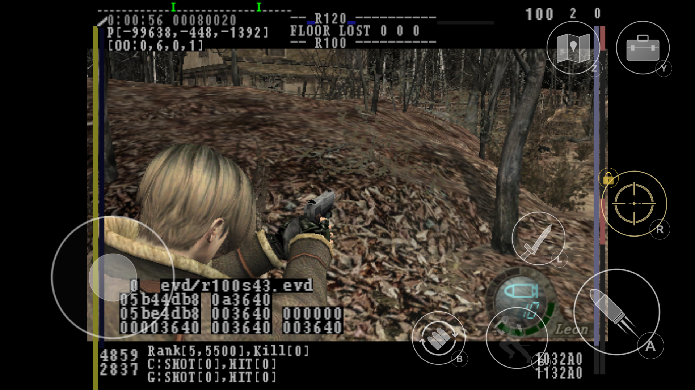
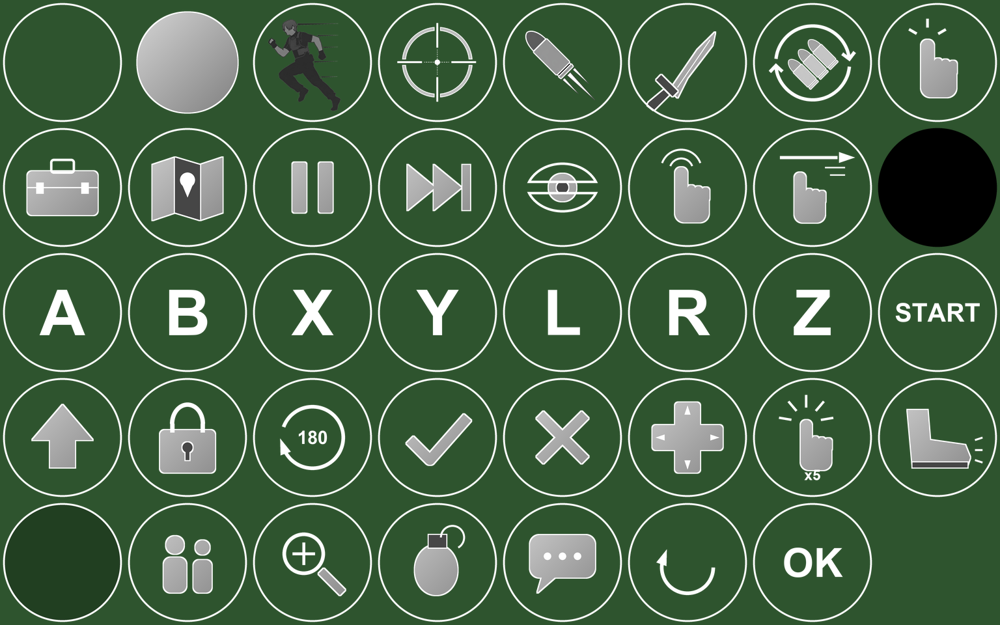

# Resident Evil 4 — Native Port, Matching Decompilation & Static Recompilation (GameCube)

[](https://creativecommons.org/publicdomain/zero/1.0/)
[](https://discord.gg/AXAzExECSv)
[]()

A complete, 100% native source port, byte-identical decompilation, and static recompilation suite for **Resident Evil 4 (Nintendo GameCube, G4BE08)** targeting modern operating systems: **Windows**, **Linux**, **Android**, and **iOS**.

There is no emulator: the game code compiles directly to native machine instructions (x86, x86_64, ARM32, ARM64), communicating directly with host operating systems and GPUs via an OpenGL ES 3.0 / Metal translation layer.


*Running 100% natively on a 2014 Samsung Galaxy S5 (Snapdragon 801/805, 32-bit ARM) in the village, locked at 30 FPS with custom touch HUD.*

> [!IMPORTANT]
> **Bring Your Own Game (BYOG)**: This repository contains **NO game assets, audio, textures, 3D models, or copyrighted binaries**. You must provide your own legally dumped GameCube disc image (`.iso`, `.gcm`, or `.rvz`) to play. The built-in launcher verifies and extracts the required data locally on your device.

---

## Supported Architectures & Platforms

| Platform | Architecture | Status | Graphics & Audio | Controls |
|---|---|---|---|---|
| **Windows** | `x86_64` (64-bit), `x86` (32-bit) | Full Playthrough (Village to Castle) | OpenGL 3.3 / GLES 3.0, AX Mixer | Keyboard & Mouse, XInput / DirectInput Gamepads |
| **Linux** | `x86_64` (64-bit) | Full Playthrough | OpenGL / SDL2, AX Mixer | Gamepad, Keyboard & Mouse |
| **Android** | `arm64-v8a` (64-bit ARM), `armeabi-v7a` (32-bit ARM), `x86_64` | Stable 30 FPS (from modern flagships down to Galaxy S5) | OpenGLES 3.0 direct translation, AX Mixer | Dynamic Touch HUD (Adaptive), Bluetooth Controllers |
| **iOS** | `arm64` (64-bit ARM, iOS 14.0+) | Native 30 FPS (`.ipa` package) | CAEAGLLayer / Metal bridge, AudioUnit | Adaptive Multi-Touch Overlay, MFi Gamepads |

---

## Key Pillars of the Project

### 1. 100% Native Port
- **Zero Emulation Overhead**: CPU registers and GameCube hardware calls are replaced by native platform abstractions (`port/os.cpp`, `port/gx.cpp`, `port/dvd.cpp`, `port/audio_port.cpp`).
- **Authentic 30 FPS Pacing**: Frame pacing strictly synchronized to GameCube hardware timing (33.33ms per frame), ensuring original physics, animations, and AI behaviors operate flawlessly.
- **Widescreen & Aiming Enhancements**:
  - 16:9 anamorphic widescreen rendering.
  - Optional Wii Edition pointer-style free aiming with mouse or analog stick.
- **Virtual Memory Card**:
  - Native save system saving directly to a virtual memory card file (`.raw`), fully functional at all typewriters.

### 2. Matching Decompilation
- Reconstructs the complete C/C++ source code of the GameCube debug prototype (`G4BE08`, Nov 25 2004).
- **992 translation units** (673 in `main.dol`, 319 across 110 REL modules) matching byte-for-byte against the original compiler output (GCC 2.95.3 / SN Systems ProDG & CodeWarrior).
- Verified via `configure.py && ninja` using `decomp-toolkit` and `objdiff`.

### 3. Static Recompilation (`recomp/`)
- Integrated static recompiler tool (`njrecomp`) capable of parsing PowerPC binaries, analyzing control flow, detecting functions, and emitting optimized native C++ code for multi-region dispatches.

---

## Adaptive Touch Controls (Mobile)



On Android and iOS, the virtual HUD adapts seamlessly based on the in-game state:
- **Exploration**: Analog movement stick, double-tap auto-run, quick turn, knife draw, interact/action button.
- **Weapon Aiming**: Over-the-shoulder free-aim zone, laser sight adjustment, fire and reload buttons.
- **Action & QTEs**: Context-sensitive swipe, tap, and mash buttons (including boulder evasion and boss fights).
- **Inventory & Menus**: Direct touchscreen tap to select, rotate, and arrange items inside the attaché case.
- **Cutscenes**: Seamless cutscene playback with optional skip toggle.

---

## Monorepo Architecture

```
Resident-Evil-4-Native-Port/
  ├── src/          # Matching decompiled game logic (992 units)
  ├── include/      # Game structures and SDK interfaces
  ├── port/         # Platform abstraction (OS, DVD, VI, Audio, GX/GLES hardware layer)
  ├── runtime/      # Nightjar engine runtime (Launcher, AX mixer, ImGui frontend)
  ├── android/      # Android NDK build scripts, RE4Activity, touch overlays
  ├── ios/          # iOS Xcode project, CAEAGLLayer Metal bridge, touch overlays
  ├── recomp/       # Static analysis and recompilation engine (njrecomp)
  ├── tools/        # Decompilation tools, symbol extractors, build helpers
  ├── images/       # Screenshots, visual documentation, control icons
  ├── CMakeLists.txt# Root unified build system
  ├── BUILDING.md   # Step-by-step compilation manual
  ├── LEGAL.md      # Bring Your Own Game (BYOG) policy & CC0 license
  └── README.md     # Project overview and documentation
```

---

## Quick Start (Playing)

1. Obtain a release build for your operating system:
   - **Windows**: `RE4Native.exe`
   - **Android**: `RE4-Native.apk`
   - **iOS**: `RE4-Native.ipa` (sideload via AltStore, TrollStore, or Xcode)
2. Launch the application to open the **Nightjar Launcher**.
3. Direct the launcher to your legal GameCube disc image of *Resident Evil 4* (`.iso`, `.gcm`, or `.rvz`).
4. The launcher automatically verifies disc hashes, extracts necessary game data, and launches the native engine.

---

## Building from Source

Detailed compilation guides for all architectures are provided in [BUILDING.md](BUILDING.md).

```sh
# Windows (x86_64 / x86):
cmake -B build -G "Visual Studio 17 2022" -A x64
cmake --build build --config Release

# Android (arm64-v8a / armeabi-v7a):
./android/build_apk.sh arm64-v8a

# iOS (arm64):
xcodebuild -project ios/RE4Native.xcodeproj -configuration Release -sdk iphoneos

# Decompilation Verification:
python3 configure.py && ninja
```

---

## Legal & Compliance

Please review [LEGAL.md](LEGAL.md) for full compliance details.

- *Resident Evil* and *Biohazard* are registered trademarks of **Capcom Co., Ltd.**
- *Nintendo GameCube* is a registered trademark of **Nintendo Co., Ltd.**
- This project is an independent open-source fan preservation initiative and is **not affiliated with, endorsed by, or sponsored by Capcom or Nintendo**.
- All game assets must be legally sourced by the end user from their own original retail game media.

---

## Credits & Acknowledgements

- **st4rwhx**: Project lead, native port architecture, GameCube platform abstraction layer (`port/`), Nightjar engine runtime, Android (32/64-bit) and iOS (64-bit) native implementations, dynamic touch controls, and initial symbol recovery pipeline (September 10, 2026).
- **Aditya "Adonis" Singh**: Upstream GameCube matching decompilation codebase ([adonis-singh/re4](https://github.com/adonis-singh/re4)), dedicated to the public domain under CC0 1.0.
- **Capcom & Nintendo**: Original creators of Resident Evil 4 and the Nintendo GameCube platform.
- **Community & Third-Party Projects**:
  - [SDL2](https://www.libsdl.org/) (zlib license)
  - [Dear ImGui](https://github.com/ocornut/imgui) (MIT license)
  - [zstd](https://github.com/facebook/zstd) (BSD license)
  - [tomlplusplus](https://github.com/marzer/tomlplusplus) (MIT license)
  - [Dolphin Emulator](https://dolphin-emu.org/) & [YAGCD](https://www.gc-forever.com/yagcd/) community for GameCube hardware documentation.

---

## Community & Support

- **Discord**: Join our community for help, bug reports, and discussion: [discord.gg/AXAzExECSv](https://discord.gg/AXAzExECSv)
- **Issues**: Report bugs or technical issues via GitHub Issues. Please do not attach copyrighted game files or ROMs.
