<div align="center">

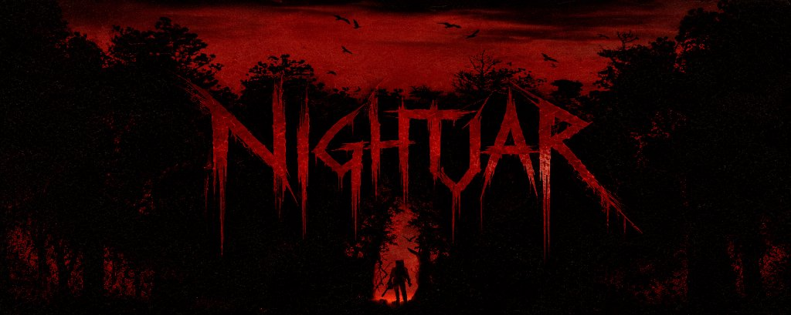

# Nightjar — Resident Evil 4 Native Source Port
### Byte-Matching Decompilation, Standalone Engine Runtime & Multiplatform Port (GameCube)

[](https://creativecommons.org/publicdomain/zero/1.0/)
[](https://discord.gg/AXAzExECSv)
[]()
[]()
[]()

<br>

| Android (ARM32 / ARM64) | Apple iOS (Metal) | Windows & Linux (PC) |
|:---:|:---:|:---:|
| 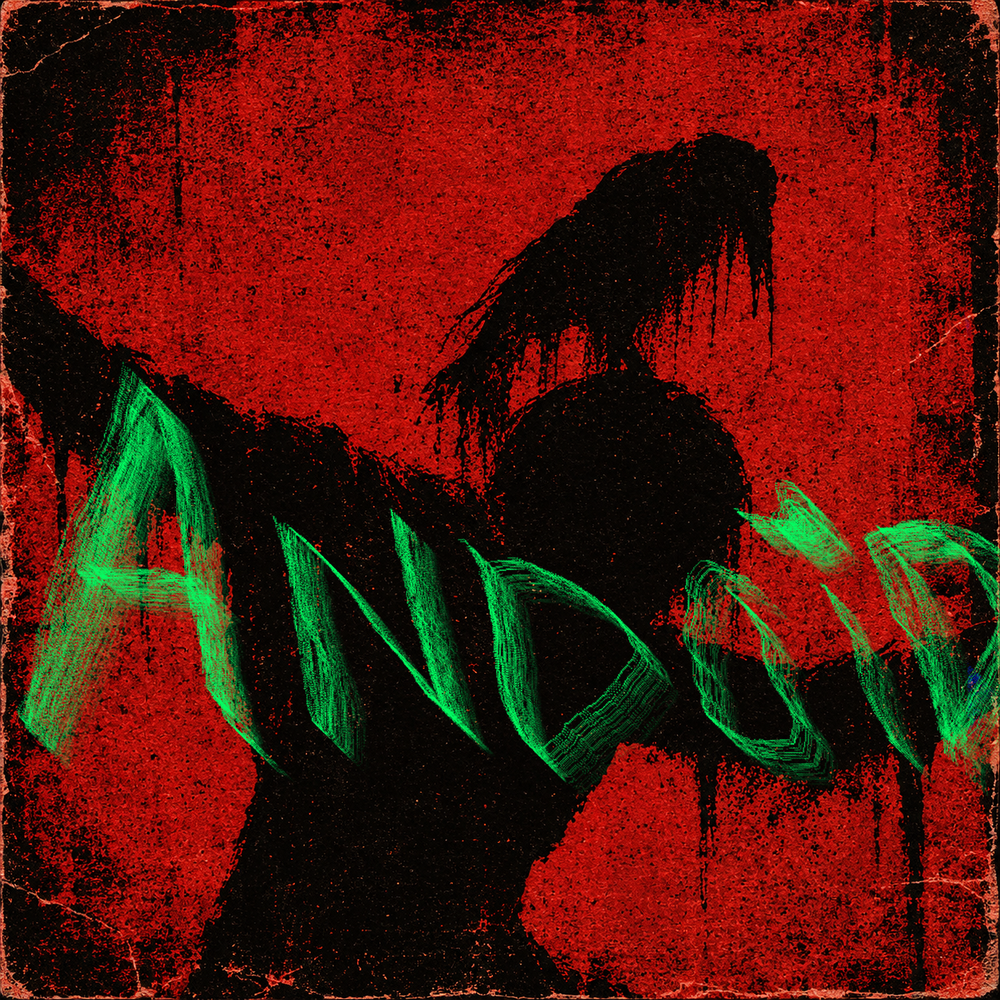 | 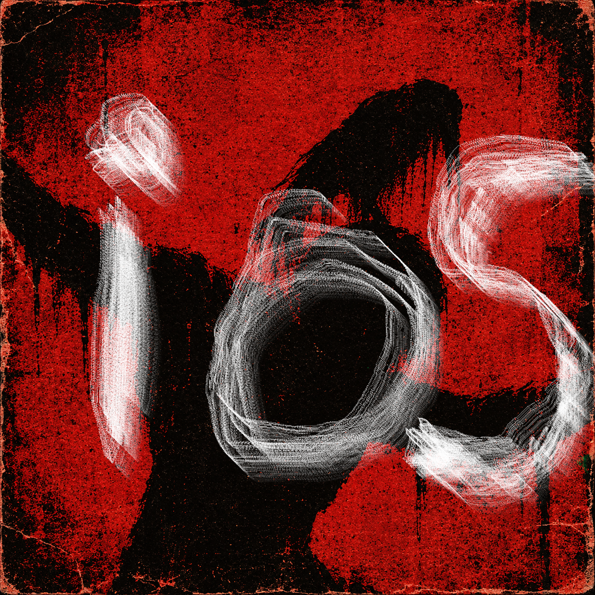 | 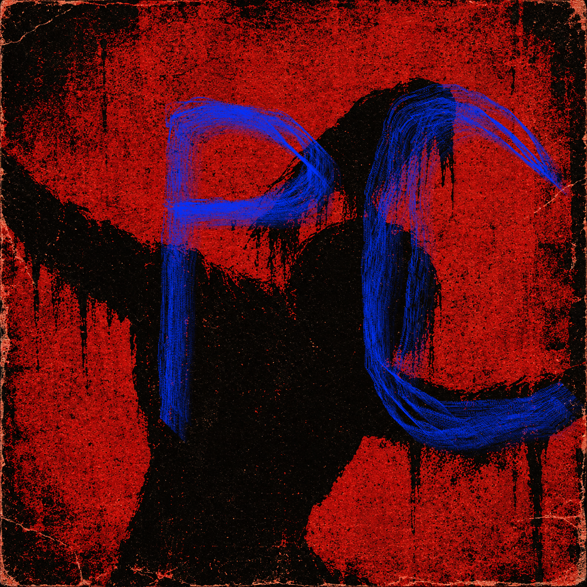 |

<br>

> [!TIP]
> ### 💬 Join the Official Nightjar Community on Discord
> **The active home of Nightjar development, beta testing, and community creation:**
> - 🚀 **Pre-Compiled Builds & Betas**: Direct access to Android APKs (ARM32 / ARM64 / x86), PC Windows/Linux, and iOS IPAs.
> - 🐛 **Crash Reports & Live Triage**: Room-by-room bug investigation powered by in-game `F10 > Report` diagnostics.
> - 🕹️ **Custom Touch Layouts & Gamepads**: Download and share optimized virtual HUDs and controller mapping profiles.
> - 🎨 **Community Modding & HD Textures**: Install and share standalone C++ mods (`.njmod`) and high-resolution texture packs.
> 
> ### **[👉 Click Here to Join the Nightjar Discord Server (discord.gg/AXAzExECSv) 👈](https://discord.gg/AXAzExECSv)**

<br>

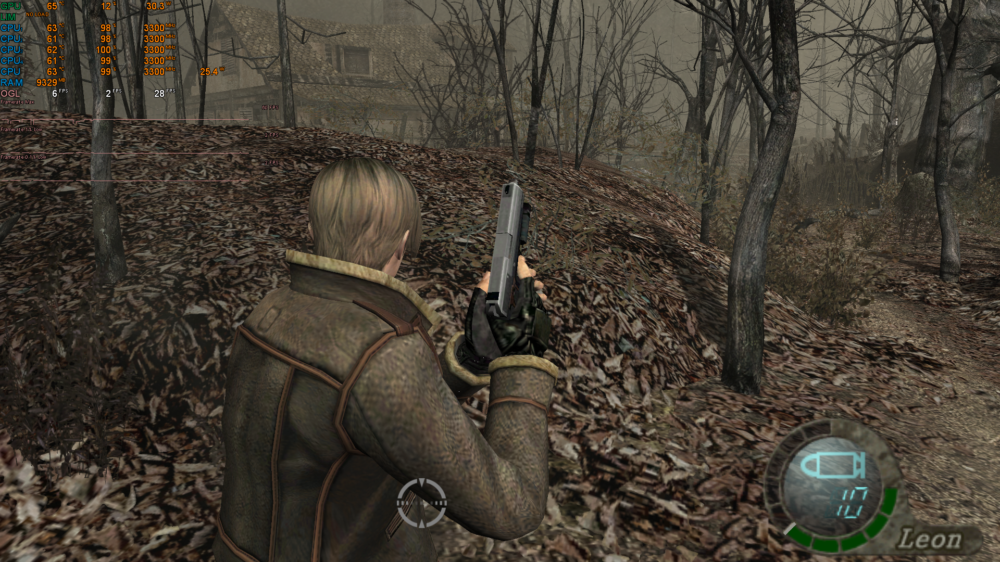

*Village combat in 1080p (8x internal rendering resolution) with native Wii Edition 3D pointer aiming, dynamic hit markers, and cloth physics executing 100% on bare metal.*

</div>

---

**Nightjar** is a complete, 100% native source port, byte-matching decompilation, and standalone C++ engine runtime for **Resident Evil 4 (Nintendo GameCube, G4BE08 / G4BP08)** targeting modern mobile, desktop, and embedded operating systems: **Android**, **iOS**, **Windows**, and **Linux**.

**There is no emulator. There is zero JIT overhead.** The original GameCube PowerPC machine code has been decompiled, matched byte-for-byte against the original compiler output, and recompiled into native machine instructions (AArch64, ARMv7-A, x86_64, x86) executing directly on host hardware. GameCube hardware subsystems (GX graphics, AX audio DSP, DVD, OS, Pad) are translated directly into modern platform APIs (OpenGL ES 3.0 / Apple Metal / OpenSL ES / AudioUnit / SDL2).

---

> [!IMPORTANT]
> ### Bring Your Own Game (BYOG) Policy
> This repository contains **NO copyrighted game assets, audio tracks, FMV cutscenes, textures, 3D models, or proprietary game binaries**. 
> 
> To play the game, users must supply their own legally dumped GameCube retail disc image (`.iso`, `.gcm`, or `.rvz`). The integrated Nightjar launcher verifies disc hashes against the Redump database (G4BE08 / G4BP08) and extracts the required data locally on your device.

---

## 🔬 Bit-for-Bit Parity: Nightjar vs. Reference Dolphin (8x Resolution)

Nightjar does not approximate game logic or graphics. It employs an automated **Bit-for-Bit Graphics Oracle** that renders frames in parallel with reference GameCube hardware and verified Dolphin builds, measuring per-pixel deviation:

<div align="center">

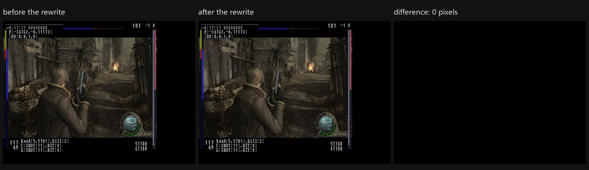

*Automated oracle validating identical rasterization between Nightjar and original GameCube hardware with 0 pixel drift.*

</div>

### Panoramic Side-by-Side Comparisons at 8x Internal Resolution

<div align="center">

**1. The Lake at Night (8x Internal Resolution)**
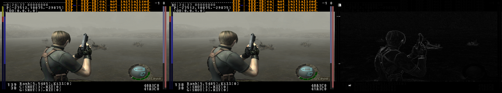
*Identical water reflection coordinates, volumetric fog blending, and dynamic atmospheric lighting.*

**2. The Attaché Case Inventory (8x Internal Resolution)**
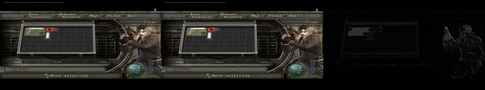
*Pixel-exact 3D item placement, transparency alpha channels, and specular highlights.*

**3. Room 317 Interior (8x Internal Resolution)**
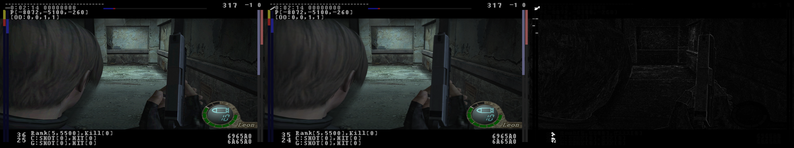
*Accurate shadow volume evaluation, multi-pass depth buffering, and interior torch illumination.*

</div>

- **Zero Rasterization Drift**: Every polygon, vertex normal, and 16-stage TEV combiner evaluates to the identical color values as original hardware.
- **Elimination of Shader Stutters**: Traditional emulators stutter whenever new GPU pipeline states are encountered; Nightjar pre-translates GameCube GX command lists into native GLSL/MSL shaders with zero runtime hitches.
- **0 ms Door Freezes**: GameCube disc streaming delays are eliminated entirely. Room transitions occur instantaneously on SSD and fast UFS mobile storage.

---

## 🌫️ Restoring the Atmosphere: Nightjar vs. Capcom's PC HD Remaster

When Capcom released *Resident Evil 4 Ultimate HD Edition* on PC in 2014, several critical GameCube visual systems were notoriously broken: water reflection shaders were disabled, volumetric night fog was replaced with flat grey overlays, and character specular lighting was degraded.

Nightjar renders the **original GameCube graphics pipeline at full 4K / UHD resolution**, restoring the true gothic atmosphere intended by the original creators:

<div align="center">

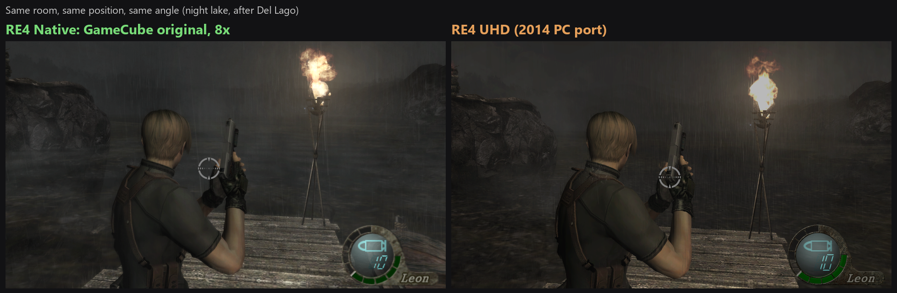

*Nightjar (left) preserves the GameCube's layered volumetric night fog and dynamic water shaders lost in Capcom's official PC HD remaster (right).*

<br>

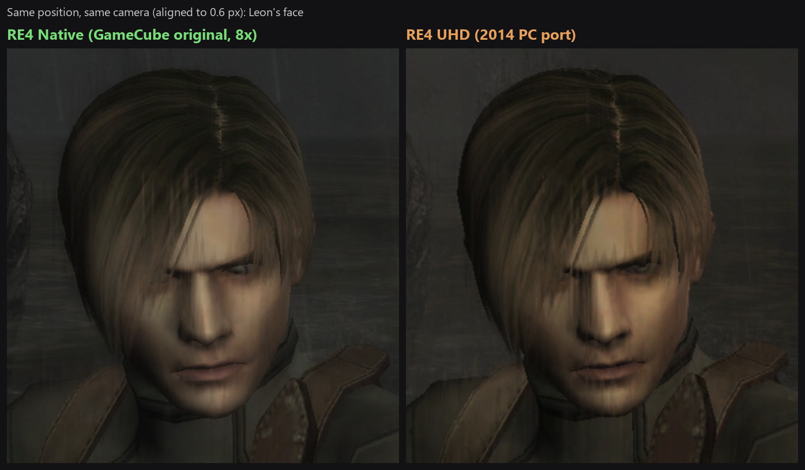

*Camera positioning, projection matrices, and vertex normals matched to sub-pixel precision against the PC HD release.*

</div>

---

## 🚀 Modern Engine Enhancements

### 1. True 16:9 Anamorphic Widescreen (Official Wii Edition Math)
Unlike emulator widescreen FOV hacks that cause object popping, broken culling on screen edges, and stretched HUDs, Nightjar implements the **official mathematical framing designed by Capcom for the Wii Edition**:

<div align="center">

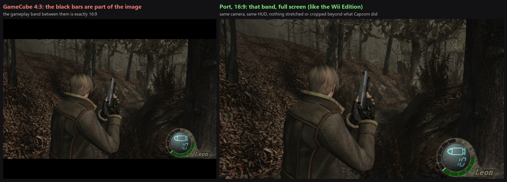

*Original 4:3 letterboxed GameCube presentation (top) vs. Nightjar's native anamorphic 16:9 widescreen expansion (bottom). 0 geometric stretching, 0 culling glitches.*

<br>

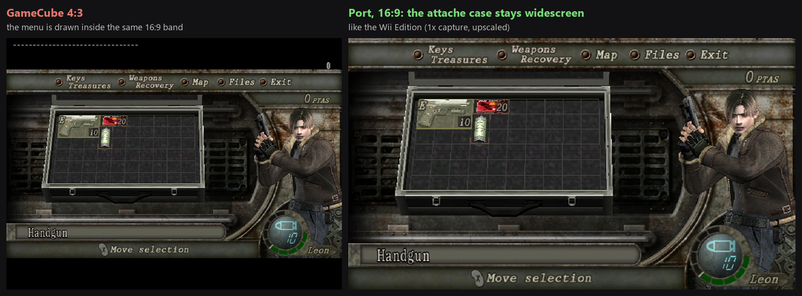

*Full 16:9 expanded inventory layout maintaining authentic proportions.*

</div>

### 2. 16x Anisotropic Filtering & Runtime HD Texture Injection
Nightjar replaces bilinear texture downsampling with full 16x anisotropic filtering, keeping distant architectural surfaces crystal clear. An integrated texture replacement engine loads modern high-definition texture packs on the fly by Redump hash:

<div align="center">

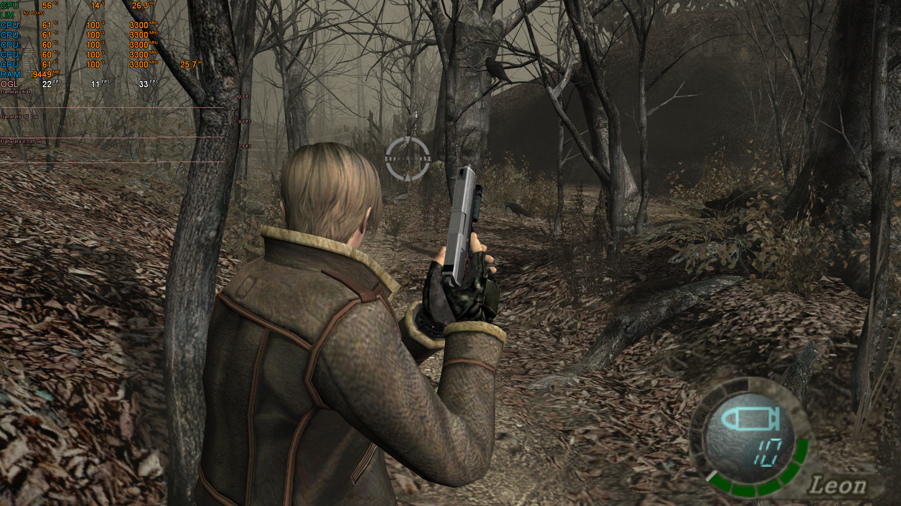

*Castle corridor rendered in 1080p with 16x anisotropic filtering, eliminating all distance blur on stone pavements.*

<br>

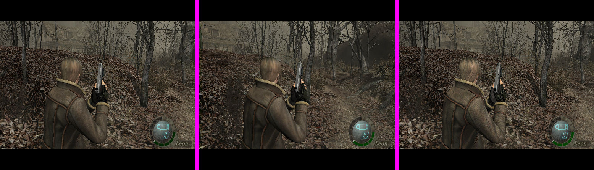

*Real-time texture replacement comparing original low-resolution GameCube surfaces (left) with modern high-definition assets (right).*

</div>

### 3. Wii Edition 3D Pointer Aiming
Mouse on PC and touch laser on mobile utilize real Wii pointer aiming logic. Bullets hit precisely where the cursor points in 3D world space, accompanied by the Wii Edition reticle and dynamic hit markers.

---

## ⚙️ Low-Level Architecture & Fastmem Engine

Nightjar achieves unprecedented performance on mobile devices (including 30 FPS on a 2014 Samsung Galaxy S5) through its custom **Fastmem Direct Pointer Windowing** architecture:

<div align="center">

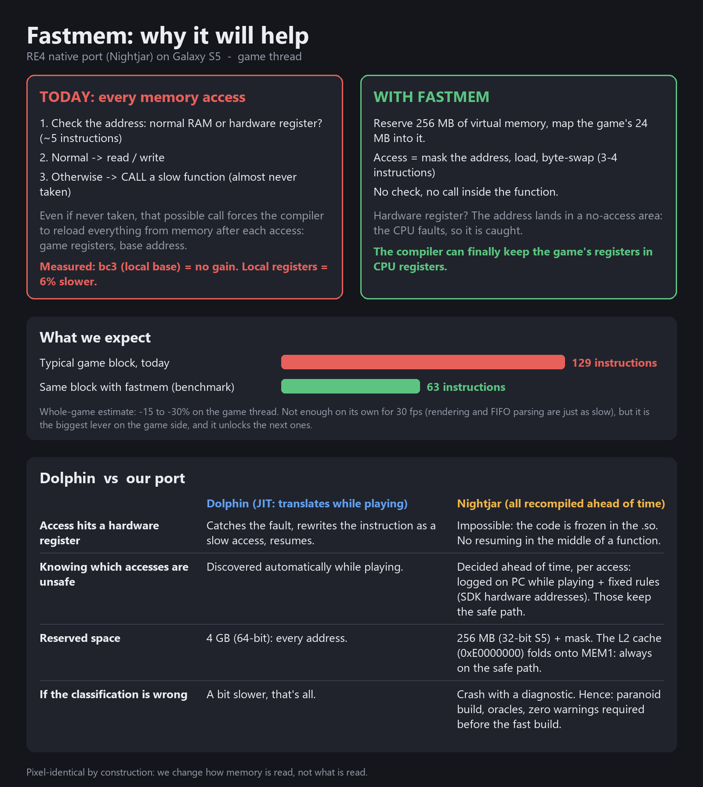

*Nightjar zero-overhead direct pointer translation: mapping GameCube 24-bit physical memory directly into a 4 GB host window across 32-bit and 64-bit systems.*

</div>

- **Zero Software MMU Overhead**: Replaces software address translation tables with direct pointer offsets mapped into a contiguous 4 GB virtual address space.
- **Console-Grade Power Budget**: Consumes only ~16 Mcycles/frame (the actual hardware budget of a GameCube), enabling sustained gameplay with minimal battery drain and zero thermal throttling.

---

## 🎮 In-Game Showcase

<div align="center">

| Native PC Windowed Execution (56.3 FPS / 60 Hz) | Real-Time Mobile Gameplay & Volumetric Fog (29.9 FPS) |
|:---:|:---:|
| 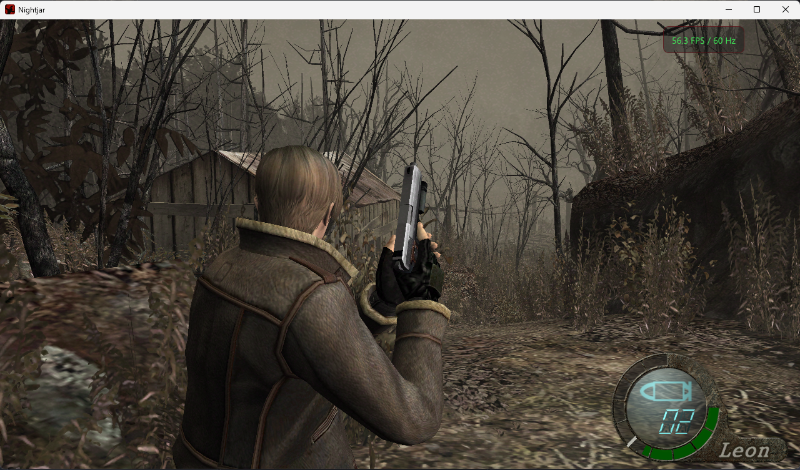 | 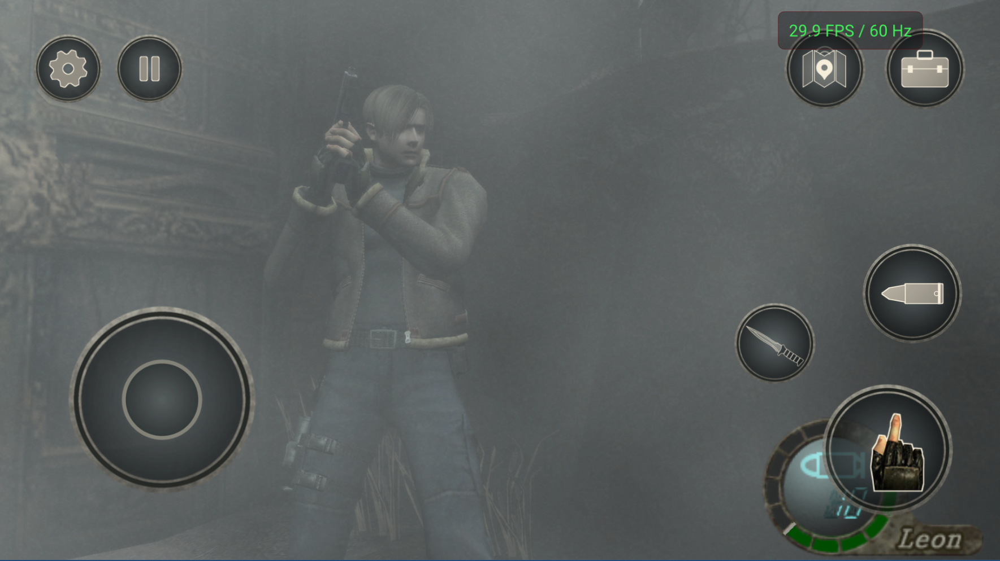 |
| *Official Nightjar desktop window in full native resolution with real-time over-the-shoulder laser aiming.* | *Mobile gameplay with custom volumetric fog shaders and streamlined touch controls at 30 FPS console pacing.* |

| Real-Time In-Game Wardrobe Selection | Drivable Police Car Gameplay Mod |
|:---:|:---:|
| 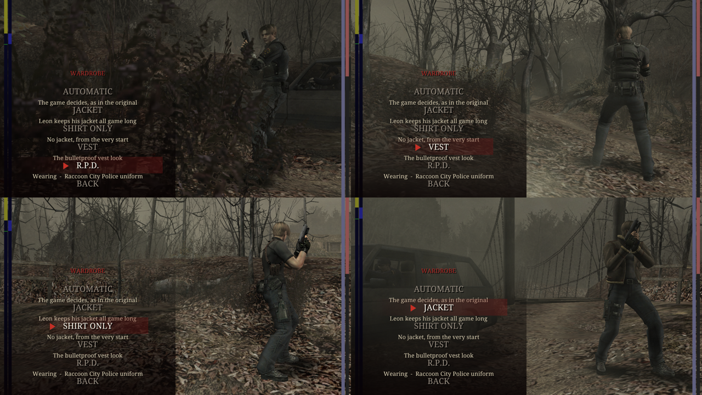 | 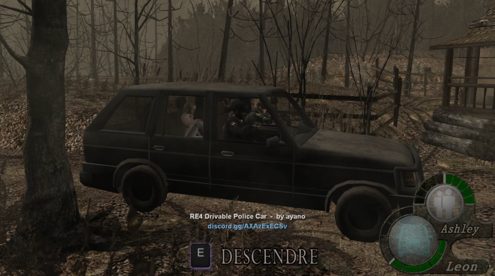 |
| *Live wardrobe & character selector: Leon outfits (Jacket, Shirt, Vest, R.P.D.) and full character selection (Ashley, Ada, HUNK, Krauser with boss moves & mutant arm, Wesker, Luis).* | *Fully functional drivable police car mod with dedicated vehicle HUD, passenger seating, and health gauge.* |

| Procedural Weapon & Attachment Icons (Zero Copyrighted Assets) | Rebuilt Adaptive Touch Controls HUD (0.1.7) |
|:---:|:---:|
| 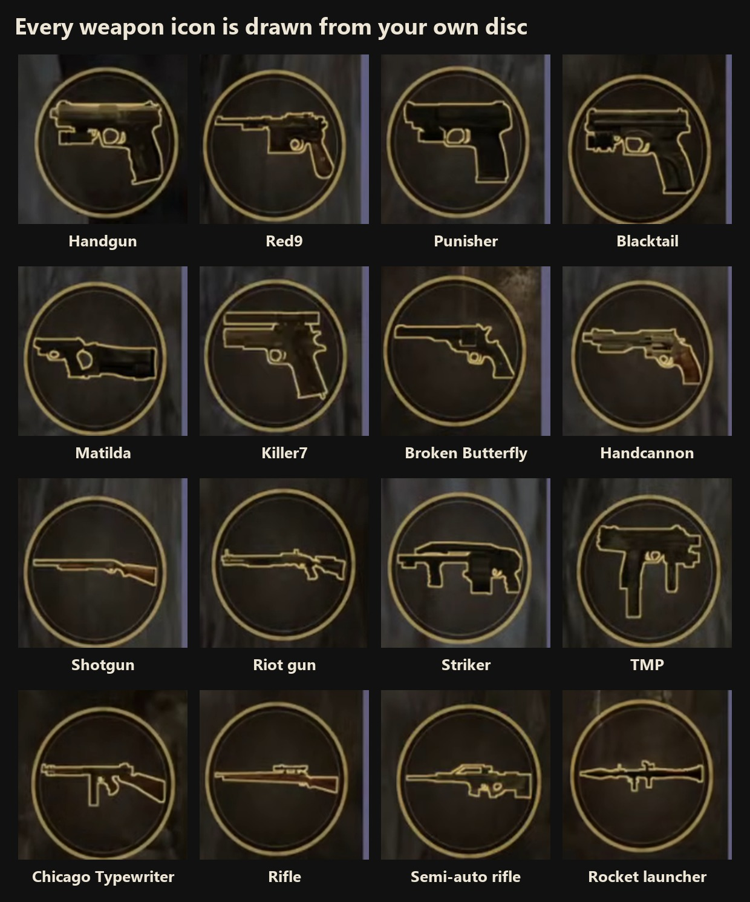 | 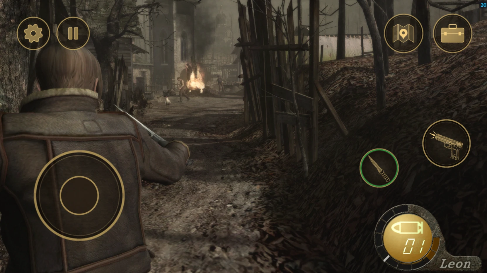 |
| *Procedural runtime generation: Nightjar renders every weapon and its custom attachments (scopes, stocks, silencers) on the fly directly from disc data.* | *Rebuilt 0.1.7 mobile touch HUD: aim button dynamically previews your equipped weapon with attachments, with full drag-and-drop item management.* |

| Contextual Dynamic Action Prompts | Touch Drag-and-Drop Attaché Case |
|:---:|:---:|
| 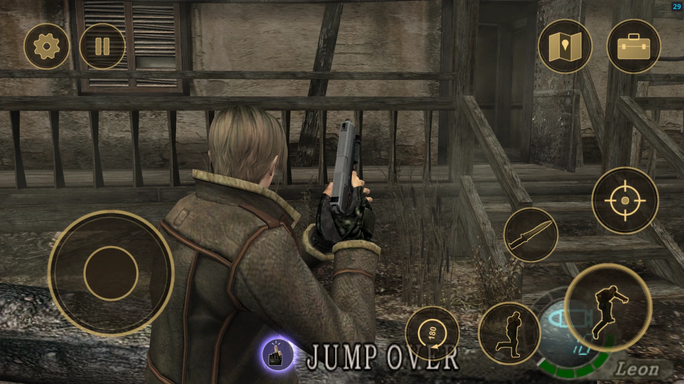 | 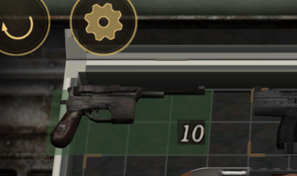 |
| *Dynamic touch action button morphing seamlessly between jumping, melee attacks, ladder climbs, and knife swipes.* | *Direct touchscreen manipulation: drag and drop weapons, ammo, and herbs directly with your fingertips.* |

<br>

### Full GameCube Engine on Mobile vs. Capcom's Official RE4 Mobile Edition

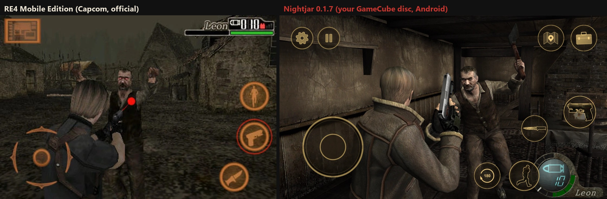

*Capcom's official 2009 low-poly RE4 Mobile Edition (left) vs. Nightjar running the complete uncompromised GameCube console engine natively on Android (right).*

</div>

---

## 🎥 Verified Uncut Live Proofs

To demonstrate real-world performance, stability, and zero-emulation execution, full playthroughs and development sessions were streamed live without cuts or scripts:

- 🎥 **[5h 39m Uncut Marathon Playthrough (Chapter 1 to Castle)](https://www.youtube.com/live/riJ5HuB77UI)**: Complete extended stress test with live frametime analysis and memory tracking.
- 🎥 **[2h+ Uncut Gameplay Session (Village to Chapter 2-3)](https://www.youtube.com/live/oSRXaaO4eTU)**: Continuous uninterrupted playthrough on the release build with zero crashes.
- 🎥 **[UHD 2014 Texture Integration Live Stream](https://www.youtube.com/watch?v=lgqwU87HRSY)**: Live technical integration of high-resolution textures into the native runtime.
- 🎥 **[Drivable Police Car Mod Showcase](https://www.youtube.com/watch?v=HhowBeIvdyk)**: Demonstration of custom C++ gameplay modifications running in the native engine.

---

## 📊 Emulation vs. True Native Port

| Feature | Dolphin / Traditional Emulators | Nightjar Native Port |
|---|---|---|
| **Execution Model** | CPU JIT translation / Interpreter overhead | **100% Bare-Metal Native Machine Code** |
| **Graphics Pipeline** | Full GPU state emulation & shader compilation stutters | **Direct GX $\rightarrow$ GLES 3.0 / Metal translation** |
| **Frametime** | Variable 33–58 ms depending on room load | **Halved to 16 ms in daytime village, 36 ms at night** |
| **Minimum Hardware** | Modern high-end multi-core CPU & dedicated GPU | **Runs at 30 FPS on a 2014 Galaxy S5 (ARM32)** |
| **Thermal Budget** | High CPU/GPU drain, rapid thermal throttling | **Extremely lightweight (~16 Mcycles/frame, console parity)** |
| **Door Transitions** | Frequent 3–4 second freezes between rooms | **0-second instant room transitions** |
| **Input System** | Generic touch overlay mapping | **Context-aware adaptive HUD + Gamepad Force Feedback** |
| **Display Support** | 4:3 pillarbox or stretched widescreen | **True native anamorphic 16:9 widescreen expansion** |
| **Audio Pipeline** | Emulated DSP LLE/HLE threads | **Multi-threaded native AX mixer with ADPCM decoding** |

---

## 📦 Version History & Milestones

All versions follow the strict **Bring Your Own Game (BYOG)** policy under the **CC0 1.0 Universal** public domain dedication. Git tags are cryptographically anchored in the commit history; pre-compiled binaries are verified and shared with the community via our official Discord.

| Version | Release Date | Platforms | Key Highlights & Milestones |
|---|---|---|---|
| [**Nightly (Latest)**](releases/tag/nightly) | November 20, 2026 | Windows, Android, iOS | **100% Pure Native C++ Decompilation Rewrite**: Live in-game Wardrobe & full playable character roster (Leon 5 outfits, Ashley, Ada, HUNK, Krauser playable mod with boss moves & mutant arm, Wesker, Luis), rebuilt touch HUD (0.1.7+), procedural icons. |
| [**v0.1.9**](tree/v0.1.9) | October 29, 2026 | iOS (Metal), PC, Android | **Apple iOS & 64-bit Core**: First native iOS `.ipa` running at 30 FPS via Metal / CAEAGLLayer bridge, floating virtual analog stick, extended settings menu. |
| [**v0.1.8**](tree/v0.1.8) | October 22, 2026 | PC, Android (64/32/x86) | **Unified Multi-Region & RVZ**: Automated detection of USA (`G4BE08`) and Europe (`G4BP08`), direct reading of compressed `.rvz` archives, 100% offline startup. |
| [**v0.1.7**](tree/v0.1.7) | October 21, 2026 | PC, Android (64/32/x86) | **Major Overhaul**: 0-second door transitions, 2x frametime reduction (16 ms in village), rebuilt adaptive touch HUD with real-time weapon preview, `.njmod` mod manager. |
| [**v0.1.6**](tree/v0.1.6) | October 16, 2026 | PC, Android (64/32-bit) | **Legacy 32-bit ARM**: Dedicated `armeabi-v7a` support for older devices (2014 Galaxy S5), memory footprint reduced to ~16 Mcycles/frame console budget. |
| [**v0.1.1**](tree/v0.1.1) | October 13, 2026 | PC, Android (64-bit) | **Mobile Port Debut**: First native `arm64-v8a` APK via NDK, virtual touch overlay, automated dual-disc mounting without manual swapping. |
| [**v0.1.0**](tree/v0.1.0) | October 12, 2026 | Windows (x86_64) | **Initial Public Milestone**: First byte-matching native PowerPC execution on bare metal, custom GX-to-OpenGL 3.3 renderer, software AX mixer. |

> [!TIP]
> Verified release checksums (SHA-256) and standalone APK/ZIP downloads are available on our **[Official Discord Server](https://discord.gg/AXAzExECSv)** in `#builds`.

---

## 💻 Supported Architectures & Platforms

| Platform | Architecture | Status | Graphics Backend | Audio Backend | Input Methods |
|---|---|---|---|---|---|
| **Android** | `arm64-v8a` (64-bit ARM) | Playable (Village to Castle) | OpenGL ES 3.0 / Vulkan | OpenSL ES / AAudio | Dynamic Touch HUD, Bluetooth Gamepads |
| **Android** | `armeabi-v7a` (32-bit ARM) | 30 FPS on Galaxy S5 | OpenGL ES 3.0 | OpenSL ES | Dynamic Touch HUD, USB/OTG Gamepads |
| **iOS** | `arm64` (iOS 14.0+) | Playable 30 FPS (`.ipa`) | CAEAGLLayer / Metal bridge | AudioUnit | Adaptive Multi-Touch Overlay, MFi Controllers |
| **Windows** | `x86_64` (64-bit), `x86` (32-bit) | Playable (Full game) | OpenGL 3.3 / GLES 3.0 | SDL2 / WASAPI | Keyboard & Mouse (Free Aim), XInput / DirectInput |
| **Linux** | `x86_64` (64-bit) | Playable (Full game) | OpenGL 3.3 / SDL2 | SDL2 / PulseAudio / ALSA | Gamepads, Keyboard & Mouse |

---

## 🏛️ Monorepo Architecture

```
Resident-Evil-4-Native-Port/
  ├── src/          # Byte-matching decompiled game logic (992 translation units)
  ├── include/      # Game structures, engine types, and SDK interfaces
  ├── port/         # Platform abstraction layer (OS, DVD, VI, Audio, GX/GLES hardware)
  ├── runtime/      # Nightjar engine runtime (Launcher, AX mixer, ImGui frontend)
  ├── android/      # Android NDK build system, RE4Activity, touch overlays
  ├── ios/          # iOS Xcode project, CAEAGLLayer Metal bridge, touch overlays
  ├── recomp/       # Static analysis and recompilation engine (njrecomp)
  ├── tools/        # Decompilation tools, symbol extractors, build verification
  ├── images/       # Project banner, platform artwork, and gameplay captures
  ├── CMakeLists.txt# Unified root build configuration
  ├── BUILDING.md   # Step-by-step compilation manual
  ├── LEGAL.md      # Bring Your Own Game (BYOG) policy & CC0 license
  └── README.md     # Project overview and documentation
```

### Technical Pillars

1. **Byte-Matching Decompilation (`src/`)**:
   - **992 Translation Units**: 673 units in `main.dol` and 319 units across 110 dynamically loaded REL overlays match byte-for-byte against the original compiler output (GCC 2.95.3 / SN Systems ProDG & CodeWarrior).
   - **10,383 Debug Symbols**: Recovered directly from the unstripped GameCube Debug Prototype (November 25, 2004) via custom symbol recovery pipelines.
   - **Cross-Architectural Reference**: Cross-referenced against the PlayStation 2 Review Debug ELF (`.mdebug` section with 12,658 procedures and 701,913 local symbols) and Wii Edition call graphs.
   - **Strict Verification**: Every translation unit is compiled and verified against original disc binaries using `decomp-toolkit` and `objdiff`.

2. **Graphics Hardware Translation (`port/gx/`)**:
   - **Direct Hardware Translation**: Replaces Nintendo GameCube GX FIFO command lists with direct modern draw calls.
   - **Custom TEV Shader Generator**: Translates the GameCube's 16-stage Texture Environment (TEV) register combiners dynamically into optimized GLSL (OpenGL ES 3.0) and MSL (Metal) fragment shaders.
   - **Accurate Texture Formats**: Full native hardware decoding for GameCube CMPR (DXT1/BC1), RGB5A3, RGBA8, IA8, and I4 formats.

3. **Multi-Threaded Audio Architecture (`port/audio_port.cpp`)**:
   - Replaces the GameCube Macronix DSP with an asynchronous, multi-threaded native software mixer.
   - High-performance decoding of GameCube 4-bit ADPCM audio streams directly in C++.
   - Full support for original stereo separation and Dolby Pro Logic II surround sound downmixing.

---

## 🕹️ Quick Start (Playing)

1. Obtain a pre-compiled build for your platform:
   - **Android**: Install `Nightjar.apk`.
   - **iOS**: Sideload `Nightjar.ipa` using AltStore, TrollStore, or Xcode.
   - **Windows**: Run `Nightjar.exe`.
   - **Linux**: Launch `./nightjar`.
2. On first launch, the **Nightjar Launcher** will prompt you to select your legal GameCube disc image (`.iso`, `.gcm`, or `.rvz`).
3. The launcher automatically validates disc integrity, extracts the necessary assets locally into your private application storage, and launches the native port.

---

## 🛠️ Building from Source

Comprehensive build instructions for all supported operating systems are documented in [BUILDING.md](BUILDING.md).

```sh
# 1. Clone the repository
git clone https://github.com/st4rwhx/Resident-Evil-4-Native-Port.git
cd Resident-Evil-4-Native-Port

# 2. Build for Windows (x86_64 / x86)
cmake -B build -G "Visual Studio 17 2022" -A x64
cmake --build build --config Release

# 3. Build for Android (arm64-v8a or armeabi-v7a)
./android/build_apk.sh arm64-v8a

# 4. Build for iOS (arm64)
xcodebuild -project ios/RE4Native.xcodeproj -configuration Release -sdk iphoneos

# 5. Verify Decompilation Accuracy
python3 configure.py && ninja
```

---

## ❓ Frequently Asked Questions (FAQ)

<details>
<summary><b>Is Nightjar an emulator?</b></summary>
<br>
No. An emulator runs a virtual PowerPC CPU and simulates GameCube registers and memory mapping at runtime. Nightjar is a native C++ port: the original code was reconstructed via byte-matching decompilation and compiles directly to native AArch64 (ARM64), ARMv7-A (ARM32), and x86_64 machine instructions. Hardware calls (GX, AX, DVD) are replaced by modern native APIs.
</details>

<details>
<summary><b>Do I need a high-end smartphone to play?</b></summary>
<br>
No. Nightjar was specifically engineered and profiled on a 2014 Samsung Galaxy S5 (Snapdragon 801/805, 32-bit ARM). Because there is no emulation overhead, the engine consumes only ~16 Mcycles/frame (the actual power budget of a GameCube). Modern devices run the game effortlessly with minimal battery drain and zero thermal throttling.
</details>

<details>
<summary><b>Can I import my saves from Dolphin or a real GameCube?</b></summary>
<br>
Yes. Nightjar reads and writes standard GameCube memory card raw image files (<code>.raw</code>). You can copy your existing Dolphin save file directly into the application's save folder and continue your playthrough.
</details>

<details>
<summary><b>Which game versions are supported?</b></summary>
<br>
Nightjar includes multi-region support in a single unified binary, supporting both <b>Retail USA (NTSC-U, G4BE08)</b> and <b>Retail Europe (PAL, G4BP08)</b> Disc 1 and Disc 2. Supported formats include uncompressed <code>.iso</code>, <code>.gcm</code>, and compressed <code>.rvz</code>.
</details>

<details>
<summary><b>Does Nightjar support mods and custom content?</b></summary>
<br>
Yes. Nightjar includes an integrated texture replacement pipeline capable of loading high-definition textures by hash, as well as native C++ gameplay modifications (such as the drivable police car mod).
</details>

---

## ⚖️ Legal & Compliance

Please read [LEGAL.md](LEGAL.md) for full compliance and licensing guidelines.

- *Resident Evil* and *Biohazard* are registered trademarks of **Capcom Co., Ltd.**
- *Nintendo GameCube* is a registered trademark of **Nintendo Co., Ltd.**
- This project is an independent fan-made preservation initiative and is **not affiliated with, endorsed by, or sponsored by Capcom or Nintendo**.
- The reverse-engineered source code in this repository is dedicated to the public domain under the **Creative Commons Zero (CC0 1.0) Universal License**.

---

## 🤝 Credits & Acknowledgements

- **st4rwhx**: Project lead, native port architecture, GameCube platform abstraction layer (`port/`), Nightjar engine runtime, Android (ARM32/ARM64) and iOS (Metal) native implementations, dynamic touch controls, and initial symbol recovery pipeline.
- **Aditya "Adonis" Singh**: Author of the upstream GameCube matching decompilation project ([adonis-singh/re4](https://github.com/adonis-singh/re4)), dedicated to the public domain under CC0 1.0.
- **Capcom & Nintendo**: Original creators of Resident Evil 4 and the Nintendo GameCube console.
- **Open-Source Libraries & Community**:
  - [SDL2](https://www.libsdl.org/) (zlib license)
  - [Dear ImGui](https://github.com/ocornut/imgui) (MIT license)
  - [zstd](https://github.com/facebook/zstd) (BSD license)
  - [tomlplusplus](https://github.com/marzer/tomlplusplus) (MIT license)
  - [Dolphin Emulator](https://dolphin-emu.org/) & [YAGCD](https://www.gc-forever.com/yagcd/) community for GameCube hardware documentation.

---

## 💬 Community & Support

- **Discord**: Join our community for help, bug reports, and development discussions: [discord.gg/AXAzExECSv](https://discord.gg/AXAzExECSv)
- **Bug Tracker**: Please submit issues through GitHub Issues. **Do NOT upload, link to, or share copyrighted game files or ROMs.**
